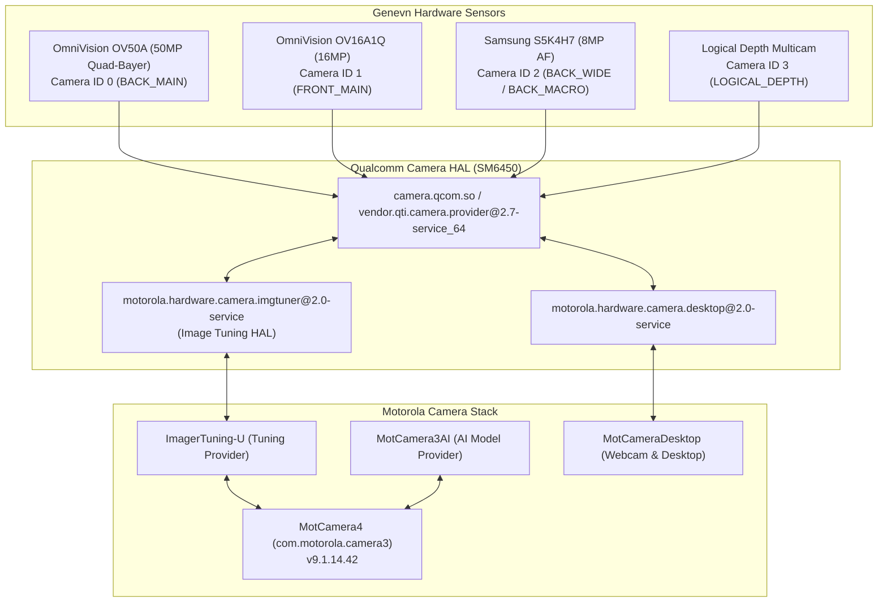

# Motorola Camera 4 Suite Compiler for Moto G Stylus 5G 2023 (`genevn`)

[](https://www.motorola.com)
[](https://wiki.lineageos.org)
[](https://lineageos.org)
[](LICENSE)

An open-source, clean-room compilation suite that extracts official **Motorola Camera 4**, proprietary camera HAL services, and multi-camera configuration blobs from official Motorola stock firmware and packages them into clean, flashable modules for **LineageOS** and custom AOSP-based ROMs.

> **Legal & Distribution Compliance**:  
> This repository contains **no proprietary binaries or copyrighted blobs**. It hosts only open-source build tooling, packaging scaffolding, and installation scripts. Users supply their own official Motorola stock firmware (downloaded directly via Motorola's Software Fix / Rescue tool).

---

## Hardware Camera Capabilities Restored

Decompiled from Motorola's device camera descriptors (`assets/config_devices_genevn` and `assets/app_feature_genevn` inside `MotCamera4.apk`):



- **Camera 0 (`BACK_MAIN`)**: 50MP OmniVision OV50A Quad-Bayer sensor. 12.5MP binned default; full 50MP Ultra-Res supported. Full 12-bit RAW DNG manual capture verified.
- **Camera 1 (`FRONT_MAIN`)**: 16MP OmniVision OV16A1Q selfie camera with HDR and face retouching.
- **Camera 2 (`BACK_WIDE` / `BACK_MACRO`)**: 8MP Samsung S5K4H7 ultra-wide angle lens with dedicated macro autofocus.
- **Camera 3 (`LOGICAL_DEPTH`)**: Multi-camera stereoscopic depth estimation for real-time portrait bokeh.
- **Full Auxiliary Access**: Unlocks Qualcomm AUX cameras (`persist.vendor.camera.expose.aux=1`).
- **OTA Survival**: Includes LineageOS `addon.d/30-motocamera.sh` backup script to survive nightly updates.

---

## System Requirements

The build script runs on Linux and requires standard Android filesystem tools:

| Tool | Ubuntu / Debian | Fedora / RHEL | Arch Linux |
| :--- | :--- | :--- | :--- |
| **`zip`** | `sudo apt install zip` | `sudo dnf install zip` | `sudo pacman -S zip` |
| **`simg2img`** | `sudo apt install android-sdk-libsparse-utils` | `sudo dnf install android-tools` | `sudo pacman -S android-tools` |
| **`lpunpack`** | `sudo apt install android-sdk-libsparse-utils` | `sudo dnf install android-tools` | `sudo pacman -S android-tools` |
| **`fsck.erofs`** | `sudo apt install erofs-utils` | `sudo dnf install erofs-utils` | `sudo pacman -S erofs-utils` |

---

## Obtaining Stock Motorola Firmware

1. Download Motorola's official **Rescue and Smart Assistant (RSA)** tool (also known as *Motorola Software Fix*) for Windows.
2. Connect your Moto G Stylus 5G 2023 in fastboot mode and choose **Rescue** $\rightarrow$ **Download Firmware**.
3. Locate the downloaded firmware directory (typically stored in `C:\ProgramData\RSA\Download\RomFiles\...`).
4. Copy the firmware folder to your Linux workstation. The folder contains `super.img_sparsechunk.0` through `super.img_sparsechunk.17`.

---

## Compiling the Modules

### Option 1: Interactive Mode
Simply run the compiler without arguments. It will prompt you to provide the firmware directory:
```bash
./compile_motocamera_package.sh
```
```text
================================================================================
        Motorola Camera 4 & Multi-Camera Suite Package Compiler                 
               Moto G Stylus 5G 2023 (genevn) for LineageOS                     
================================================================================

[INFO] Verifying host build tools...
[OK] All required build tools are installed.

Please specify the path to your downloaded Motorola stock firmware:
  (Can be a folder containing sparsechunks, partition .img files, or a .zip file)
> Path: /path/to/stock/firmware
```

### Option 2: CLI / Non-Interactive Mode
Pass the firmware path as the first argument, and optionally a custom output directory as the second argument:
```bash
./compile_motocamera_package.sh /path/to/stock/firmware [output_directory]
```

The script automatically:
1. Recombines `super.img_sparsechunk.*` into `super.raw.img` using `simg2img`.
2. Unpacks dynamic logical partitions (`product`, `system_ext`, `system`, `vendor`) via `lpunpack`.
3. Extracts partition filesystems via `fsck.erofs`.
4. Extracts only the required Motorola camera applications, companion AI services, framework signature JARs, VINTF manifests, and vendor HAL binaries.
5. Assembles both the **Recovery Installer Zip** and **Systemless Magisk / KernelSU Module**.

---

## Installation Methods

> [!TIP]
> **Install Anytime — No First-Boot Requirement**:  
> Unlike GApps (which must typically be flashed before first boot to avoid permission reconciliation failures), the Moto Camera 4 suite **does not need to be set up before first boot**. You can install it immediately after flashing your ROM, or at any time on an already set-up, running daily-driver device without wiping data or resetting settings.

> [!NOTE]
> **OTA Survival vs. Major Android Revision Sideloads**:
> * **Standard Nightly / Minor OTA Updates**: **Survives automatically**. The included `/system/addon.d/30-motocamera.sh` backup script backs up and restores all camera binaries, framework JARs, companion services, and permissions during LineageOS OTA updates.
> * **Major Android Revision Sideload Updates**: When sideloading a whole new major Android release (e.g., jumping between major LineageOS versions like 23.x to 24.x), the recovery completely rewrites the system partitions and does not execute `addon.d` across major version bumps. Simply re-flash the recovery installer package (or re-run the live installer script) after completing the major OS upgrade.

### Method 1: Recovery Sideload (Lineage Recovery / TWRP)
1. Reboot phone to Recovery.
2. In recovery, select **Apply Update** $\rightarrow$ **Apply from ADB**.
3. On your computer, run:
   ```bash
   adb sideload output/compiled/MotoCamera4_Genevn_Recovery_Installer.zip
   ```
4. If recovery displays *"Signature verification failed. Install anyway?"*, select **Yes** (standard for third-party zips).
5. Reboot to system. The `addon.d/30-motocamera.sh` script will automatically restore the camera suite during future LineageOS OTA updates.

### Method 2: Systemless KernelSU / Magisk Module
1. Transfer `output/compiled/MotoCamera4_Genevn_Magisk_KernelSU_Module.zip` to your phone storage.
2. Open the **KernelSU** or **Magisk** app $\rightarrow$ **Modules** tab $\rightarrow$ **Install from storage**.
3. Select the zip file and reboot your device.

### Method 3: 1-Click Live Installer (via ADB Root)
If your phone is booted into LineageOS with ADB root enabled in Developer Options:
```bash
./output/install_motocamera_live.sh
```
This mounts native Android OverlayFS and installs all camera components directly without modifying physical partition blocks.

---

## Project Structure

```text
├── compile_motocamera_package.sh      # Main compilation tool (handles unpacking & packaging)
├── templates/                         # Open-source module scaffolding and scripts
│   ├── recovery/                      # Update-binary, addon.d scripts, and toybox
│   └── magisk/                        # Magisk/KernelSU customize.sh, system.prop, sepolicy
├── output/                            # Output directory for compiled packages
│   ├── install_motocamera_live.sh     # 1-click live ADB environment installer
│   └── compiled/                      # Generated flashable zips
└── README.md
```

---

## Verification & Testing

Tested and verified on **Moto G Stylus 5G 2023 (`XT2315-1`, `genevn`)** on both:
- **LineageOS 23.2**
- **LineageOS 24.0 (Android 17 Preview, SDK 37)**

### Verified Features:
- [x] Official Motorola Camera 4 UI (`com.motorola.camera3` v9.1.14.42)
- [x] Rear 50MP Main sensor (binned 12.5MP and full 50MP Ultra-Res)
- [x] Front 16MP Selfie camera
- [x] Rear 8MP Ultra-Wide lens
- [x] Dedicated Macro autofocus mode
- [x] Pro manual controls & RAW DNG capture (`.dng` output)
- [x] Auto Night Vision & Scene Detection AI (`MotCamera3AI`)
- [x] Ready For / Webcam Desktop streaming (`MotCameraDesktop`)
- [x] Clean boot with SELinux Enforcing
