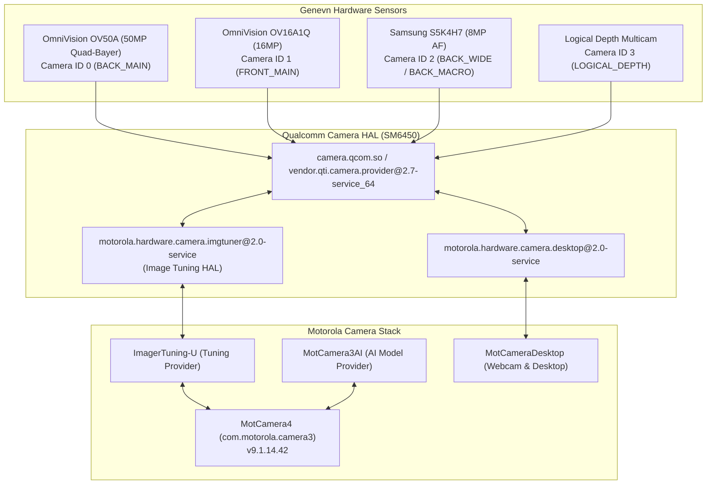

# Motorola Camera 4 Suite for Moto G Stylus 5G 2023 (`genevn`)

[](https://www.motorola.com)
[](https://wiki.lineageos.org)
[](https://lineageos.org)
[](https://mirrors.lolinet.com/firmware/lenomola/2023/genevn/official/RETUS/)
[](https://deepmind.google/technologies/gemini/)
[](LICENSE)

> [!IMPORTANT]
> ### ⚡ 100% Vibe Coded with Google DeepMind Gemini 3.8 Flash (High)
> **This entire project was vibe coded end-to-end with Google DeepMind Gemini 3.8 Flash (High / Thinking)**.  
> From dynamic partition extraction pipelines (`simg2img`, `lpunpack`, `erofs`), reverse-engineering Motorola multi-camera HAL bindings and SELinux file-context permissions down to the recovery installer update-binary and `addon.d` OTA survival engine, every line of build tooling, configuration, and documentation was developed collaboratively with Gemini 3.8 Flash High.

An open-source compilation suite that extracts official **Motorola Camera 4**, proprietary camera HAL services, and multi-camera configuration blobs from official Motorola stock firmware and packages them into a clean, flashable recovery package for **LineageOS** and custom AOSP-based ROMs.

> [!NOTE]
> **Legal & Distribution Compliance**:  
> This repository contains **no proprietary binaries or copyrighted blobs**. It hosts only open-source build tooling, packaging scaffolding, and installation scripts. Users supply their own official Motorola stock firmware.

---

## Hardware Camera Capabilities Restored

Decompiled and mapped from Motorola's device camera descriptors (`assets/config_devices_genevn` and `assets/app_feature_genevn` inside `MotCamera4.apk`):



- **Camera 0 (`BACK_MAIN`)**: 50MP OmniVision OV50A Quad-Bayer sensor. 12.5MP binned default; full 50MP Ultra-Res supported. Full 12-bit RAW DNG manual capture verified.
- **Camera 1 (`FRONT_MAIN`)**: 16MP OmniVision OV16A1Q selfie camera with HDR and face retouching.
- **Camera 2 (`BACK_WIDE` / `BACK_MACRO`)**: 8MP Samsung S5K4H7 ultra-wide angle lens with dedicated macro autofocus.
- **Camera 3 (`LOGICAL_DEPTH`)**: Multi-camera stereoscopic depth estimation for real-time portrait bokeh.
- **Full Auxiliary Access**: Unlocks Qualcomm AUX cameras (`persist.vendor.camera.expose.aux=1`).
- **OTA Survival**: Includes LineageOS `addon.d/30-motocamera.sh` backup script to survive nightly updates.

---

## Moto Camera 4 vs. Camera 3: Shared Package Name & Architecture

Users often notice that Moto Camera 4 uses the package name `com.motorola.camera3` and wonder why a standalone APK install or Play Store update fails on custom ROMs.

### Why Do Camera 4 and Camera 3 Share the Same Package Name?
Both generations identify internally as `com.motorola.camera3` (`packageName="com.motorola.camera3"`). Motorola retained this package identifier across major camera generations for:
- **Play Store & OTA Continuity**: Seamless updates across Android OS revisions without creating orphaned user profiles or duplicate app entries.
- **Android Intent Filters**: Preserving system-level camera launch shortcuts (e.g., Motorola double-twist gesture, lockscreen camera triggers, third-party app image intents).
- **Settings & Permission Persistence**: Maintaining user preferences and camera permissions across system updates.

### Architectural Differences: Monolithic vs. Decoupled

| Feature / Requirement | Moto Camera 3 (Legacy Architecture) | Moto Camera 4 (Modern Modular Suite) |
| :--- | :--- | :--- |
| **Typical Target OS** | Android 9 – Android 12 | Android 13 – Android 14+ |
| **APK Versioning** | Versions 7.x – 8.x | Version 9.x+ (e.g., `v9.1.14.42`) |
| **System APK Name** | `MotCamera3.apk` | `MotCamera4.apk` |
| **AI / Scene Detection** | Bundled internally within APK | Decoupled into `MotCamera3AI.apk` (`com.motorola.camera3.content.ai`) |
| **Image Tuning Stack** | Static tuning tables in `/vendor/etc/camera/` | Decoupled provider `ImagerTuning-U.apk` (`com.motorola.imagertuning.u`) |
| **Hardware HAL Daemon** | Relied directly on Qualcomm HAL3 | Requires HIDL service `motorola.hardware.camera.imgtuner@2.0-service` |
| **Signature Framework** | Optional / soft dependency | **Mandatory** (`com.motorola.motosignature.jar`, required in manifest) |
| **Desktop / Ready For** | Not supported | Integrated companion service (`MotCameraDesktop.apk`) |

### Why Moto Camera 4 Cannot Be Sideloaded as a Simple Loose APK

On modern devices like the Moto G Stylus 5G 2023 (`genevn`), simply downloading and installing the `MotCamera4.apk` file on a custom ROM will fail or crash immediately due to several hard dependencies:

1. **Mandatory Signature Shared Library (`com.motorola.motosignature`)**:
   `MotCamera4` declares `<uses-library android:name="com.motorola.motosignature" android:required="true"/>` in its `AndroidManifest.xml`. If `/system/framework/com.motorola.motosignature.jar` and its permission XML are missing from the OS, Android's `PackageManager` will refuse to install or start the app (`INSTALL_FAILED_MISSING_SHARED_LIBRARY`).
2. **Decoupled AI & Tuning Content Providers**:
   Without `MotCamera3AI` in `/product/app/` and `ImagerTuning-U` in `/system_ext/priv-app/`, the main UI cannot initialize night-vision heuristics, scene optimization, or HDR tone mapping.
3. **ImageTuner HIDL HAL & VINTF Manifest**:
   Motorola's post-processing engine requires `motorola.hardware.camera.imgtuner@2.0-service` running as a native daemon. The recovery package registers this service in the device VINTF manifest (`manifest_imgtuner.xml`) so the Qualcomm camera provider (`vendor.qti.camera.provider@2.7-service_64`) can bind to it.
4. **Qualcomm AUX Camera Exposure**:
   By default, custom AOSP ROMs only expose standard back and front cameras to non-system apps. Accessing the dedicated 8MP Macro lens, Ultra-Wide sensor, and full 50MP Ultra-Res raw stream requires setting system properties (`persist.vendor.camera.expose.aux=1` and `persist.vendor.camera.physical.num=3`) and permissions.
5. **Core System Frameworks**:
   The camera stack queries device cutouts, haptic feedback, and camera profiles via `moto-core_services.jar` and `moto-settings.jar`.

This compilation suite packages all of these interdependent components together so that Motorola Camera 4 functions completely with full hardware sensor access on LineageOS.

---

## Obtaining Stock Motorola Firmware

Stock firmware for the Moto G Stylus 5G 2023 (`genevn`, model `XT2315-1`) can be downloaded using either of two methods:

### Method 1: Official lolinet Firmware Mirror (Direct Web Download)
Stock ROMs can be downloaded directly from the official lolinet firmware archive:
* **Mirror Link**: [https://mirrors.lolinet.com/firmware/lenomola/2023/genevn/official/RETUS/](https://mirrors.lolinet.com/firmware/lenomola/2023/genevn/official/RETUS/)

> [!NOTE]
> **Tested & Verified Build**:  
> This project has been specifically verified and tested using stock firmware build **`U1TGNS34.42-86-2-25`** (Android 14):  
> `XT2315-1_GENEVN_RETUS_14_U1TGNS34.42-86-2-25_subsidy-DEFAULT_regulatory-DEFAULT_cid50_CFC.xml.zip`

### Method 2: Motorola Rescue and Smart Assistant (Software Fix)
1. Download Motorola's official **Rescue and Smart Assistant (RSA)** tool on Windows.
2. Connect your device in fastboot mode and select **Rescue** $\rightarrow$ **Download Firmware**.
3. Firmware files are saved in `C:\ProgramData\RSA\Download\RomFiles\...` or `C:\ProgramData\LMSA\Download\RomFiles\...`.

---

## Compiling the Recovery Package

Standalone compiler scripts for both **Linux** and **Windows** are available directly in this repository and as standalone downloads from the [GitHub Releases](https://github.com/vrwindsor1/motocamera-genevn/releases) page.

> [!TIP]
> You do **not** have to clone the entire repository. You can simply download the single script file for your OS (`compile_recovery_package_linux.sh` or `compile_recovery_package_windows.bat`) from the Releases page. The scripts will automatically fetch any required open-source templates dynamically.

### Linux Compilation

#### System Requirements
Standard Android filesystem tools are required:

| Distribution | Required Packages |
| :--- | :--- |
| **Ubuntu / Debian** | `sudo apt install android-sdk-libsparse-utils erofs-utils p7zip-full zip curl` |
| **Fedora / RHEL** | `sudo dnf install android-tools erofs-utils p7zip p7zip-plugins zip curl` |
| **Arch Linux** | `sudo pacman -S android-tools erofs-utils p7zip zip curl` |

#### Running the Compiler
Make the script executable and run it:

```bash
chmod +x compile_recovery_package_linux.sh

# Interactive mode (prompts for firmware path or zip)
./compile_recovery_package_linux.sh

# Non-interactive CLI mode
./compile_recovery_package_linux.sh /path/to/stock_firmware.zip [output_directory]
```

The Linux script automatically handles recombining `super.img_sparsechunk.*`, unpacking dynamic partitions via `lpunpack`, extracting EROFS filesystems, harvesting camera components, and packaging the recovery zip.

---

### Windows Compilation

On Windows, you can compile the package using either the batch launcher or PowerShell:

1. **Option A (Double Click)**:
   Double-click `compile_recovery_package_windows.bat`. It will launch the PowerShell builder with execution bypass and prompt you for the firmware directory.
2. **Option B (PowerShell CLI)**:
   ```powershell
   .\compile_recovery_package_windows.ps1 -FirmwarePath "C:\path\to\stock_firmware"
   ```

> [!TIP]
> On Windows, point the script to either:
> - A pre-extracted firmware folder (containing `product`, `system_ext`, `system`, and `vendor`), OR
> - Your Motorola RSA / Software Fix folder. If sparsechunks need unpacking on Windows, you can extract them via WSL (`wsl ./compile_recovery_package_linux.sh "/mnt/c/path/to/firmware"`) or 7-Zip with EROFS support.

---

## Installation via Recovery

> [!TIP]
> **Install Anytime — No First-Boot Requirement**:  
> Unlike GApps (which must typically be flashed before first boot to avoid permission reconciliation failures), the Moto Camera 4 suite **does not need to be set up before first boot**. You can install it immediately after flashing your ROM, or at any time on an already set-up, running daily-driver device without wiping data or resetting settings.

> [!NOTE]
> **OTA Survival vs. Major Android Revision Sideloads**:
> * **Standard Nightly / Minor OTA Updates**: **Survives automatically**. The included `/system/addon.d/30-motocamera.sh` script automatically backs up and restores all camera binaries, framework JARs, companion services, and permissions during LineageOS OTA updates.
> * **Major Android Revision Sideload Updates**: When sideloading a whole new major Android release (e.g., jumping between major LineageOS versions like 23.x to 24.x), recovery completely rewrites the system partitions and does not execute `addon.d` across major version bumps. Simply re-sideload the recovery installer package after completing the major OS upgrade.

### Installation Steps

1. Reboot your phone into **Recovery** (Lineage Recovery, TWRP, or OrangeFox).
2. Select **Apply Update** $\rightarrow$ **Apply from ADB**.
3. On your computer terminal, sideload the compiled package:
   ```bash
   adb sideload output/MotoCamera4_Genevn_Recovery_Installer.zip
   ```
4. If recovery prompts with:
   > *"Signature verification failed. Install anyway?"*  
   Select **Yes** (standard for custom packages).
5. Once installation finishes, select **Reboot system now**.
6. Open **Moto Camera** from your app drawer. All hardware sensors and shooting modes are active!

---

## Device & ROM Compatibility

- **Primary Device**: Motorola Moto G Stylus 5G 2023 (codename: `genevn`, `genevn_g`, model `XT2315-1`).
- **Verified ROMs**:
  - **LineageOS 23.2**
  - **LineageOS 24.0 (Android 17 Preview, SDK 37)**
- **Other Custom ROMs**: Compatible with other custom ROMs for `genevn` based on LineageOS (e.g., crDroid, Evolution X, RisingOS) that share the `genevn` device tree, Qualcomm SM6450 HALs, and standard dynamic partition layouts.

---

## Project Structure

```text
├── compile_recovery_package_linux.sh      # Linux recovery package compiler
├── compile_recovery_package_windows.bat   # Windows batch compiler launcher
├── compile_recovery_package_windows.ps1   # Windows PowerShell compiler
├── templates/                             # Open-source packaging scaffolding
│   └── recovery/                          # Update-binary, updater-script, addon.d, and toybox
├── output/                                # Destination directory for compiled packages
│   └── MotoCamera4_Genevn_Recovery_Installer.zip
└── README.md
```

---

## Verification & Testing

Tested and verified on physical hardware (**Moto G Stylus 5G 2023 `XT2315-1`** running **LineageOS 24.0 / Android 17**):

- [x] Official Motorola Camera 4 UI (`com.motorola.camera3` v9.1.14.42)
- [x] Rear 50MP Main sensor (binned 12.5MP and full 50MP Ultra-Res)
- [x] Front 16MP Selfie camera
- [x] Rear 8MP Ultra-Wide lens
- [x] Dedicated Macro autofocus mode
- [x] Pro manual controls & RAW DNG capture (`.dng` output)
- [x] Auto Night Vision & Scene Detection AI (`MotCamera3AI`)
- [x] Ready For / Webcam Desktop streaming (`MotCameraDesktop`)
- [x] LineageOS `addon.d` OTA survival
- [x] Clean boot with SELinux Enforcing
